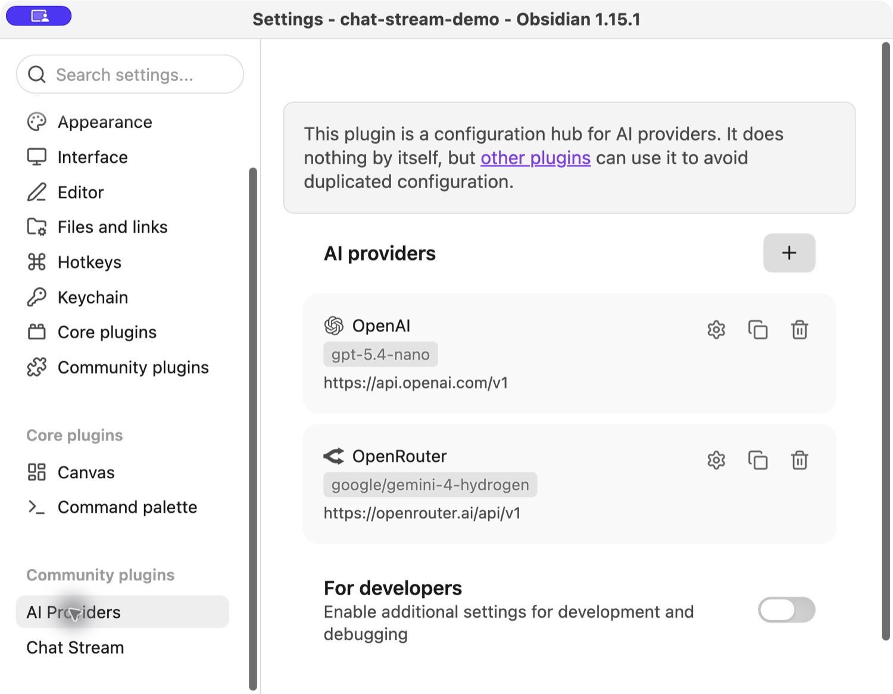
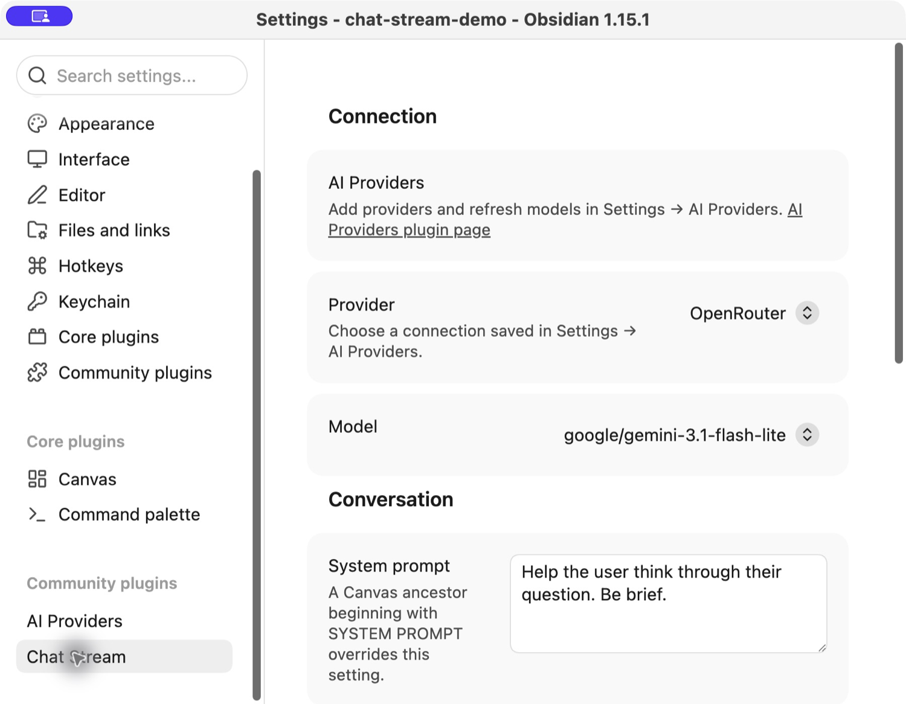

# Chat Stream

Branch an AI conversation on Obsidian Canvas. Select a card, generate a reply, and return to any earlier card to explore another direction. Incoming arrows determine what goes into the conversation.

## Get started

Install [Chat Stream](https://community.obsidian.md/plugins/chat-stream) from Community plugins on Obsidian Desktop 1.13.0 or newer, and enable the **Canvas** core plugin. To try a development build, see [CONTRIBUTING.md](CONTRIBUTING.md).

### Connect a provider

> **Upgrading to 2.0.0:** Configure your connection in **AI Providers**, then select it again in **Chat Stream**. Chat Stream does not transfer its old endpoint, API key, or model selection. Existing Canvas cards, assistant roles, and saved conversation preferences carry over.

1. Install and enable [AI Providers](https://community.obsidian.md/plugins/ai-providers) 1.13.0 or newer in the same vault.
2. Open **Settings → AI Providers**. Click **Add provider (+)**, choose a provider type, fill in its connection details, and choose a default chat model. Use **Refresh models list** in the connection editor if your model is missing, then save the connection.

   

3. Open **Settings → Chat Stream**. Choose the saved connection under **Provider** and keep its default model or pick a different **Model**. If AI Providers lists reasoning modes for the selected model, you can also choose a **Reasoning effort**.

   

### Try a branch

1. Copy [the sample Canvas and its Markdown notes](test-vault) into the root of a test vault. Open **Weekend plan.canvas**.
2. Select the left question card and run **Chat Stream: Preview context** from the command palette. The preview includes **Field notes**; the right branch does not. You can preview before setting up a provider.
3. Run **Chat Stream: Generate AI note** to create a purple reply connected to the selected card. Select the reply, run **Chat Stream: Create next note**, and type a follow-up. To branch, return to an earlier card and generate again.

For your own conversation, start with a text card on any Canvas. Add context by drawing an arrow from a text card, Markdown file card, or supported image card toward the question. Assign shortcuts under **Settings → Hotkeys** by searching for Chat Stream. If you used the old default shortcuts, you can assign them there.

### Network, privacy, and cost

- **Preview context** works locally. **Generate AI note** sends the system prompt and included Canvas text, linked Markdown content, and supported images (PNG or JPEG) to the endpoint configured in AI Providers. Check the preview before sending private material.
- AI Providers manages connections and credentials. Hosted providers generally require an account or API key and may charge for generation. Local providers require a running local model server.
- Use a model that supports vision for image cards. The text budget is approximate; images count toward provider limits separately.

### Known limitations

- Open **Chat Stream** from the settings sidebar under **Community plugins**. On Obsidian 1.13 or newer, you can also find its options using settings search.
- Some OpenRouter models can return `<think>` blocks. Chat Stream saves them as part of the reply, so they can also be included in later branch context.

## Contribute

See [CONTRIBUTING.md](CONTRIBUTING.md) for build and test instructions. The original Canvas integration drew on [Canvas MindMap](https://github.com/Quorafind/Obsidian-Canvas-MindMap). Provider access uses Pavel Frankov's [AI Providers SDK](https://github.com/pfrankov/obsidian-ai-providers/tree/master/packages/sdk). Chat Stream is [MIT licensed](LICENSE).
